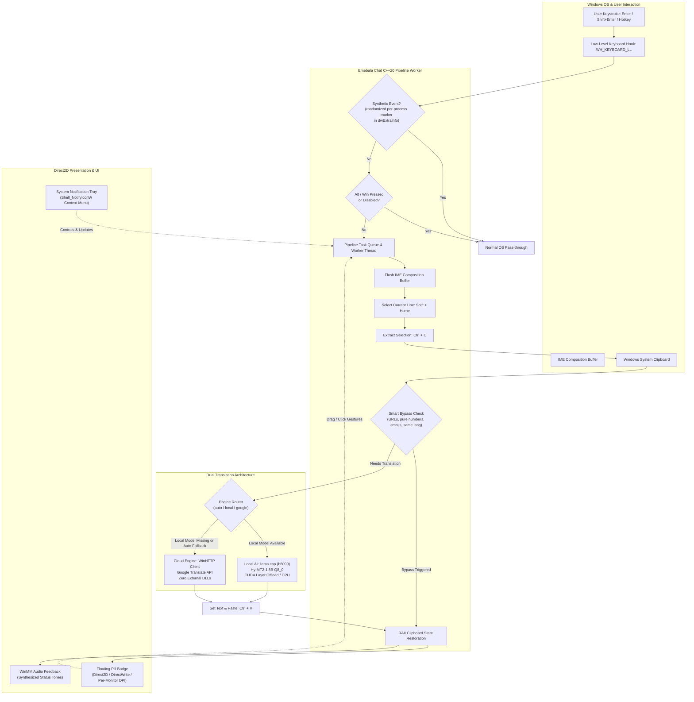

<p align="center">
  
</p>

<h1 align="center">Emebala Chat</h1>

<p align="center">
  <strong>Ultra-Fast Native Real-Time Translation for Windows</strong><br />
  "Never copy-paste again. Type in your language, and let Emebala Chat translate and replace your text in real-time anywhere."<br />
  <em>No more copy-paste context switching (복붙 없는 번역).</em>
</p>

<p align="center">
  <a href="https://github.com/teamsunplaza/Emebalachat/releases"></a>
  <a href="LICENSE"></a>
  <a href="https://microsoft.com/windows"></a>
  <a href="https://teamsunplaza.gumroad.com/l/emebala"></a>
</p>

<p align="center">
  <a href="#download-windows-10--11-x64">Download</a> ·
  <a href="#what-it-does">What it does</a> ·
  <a href="#key-features">Features</a> ·
  <a href="#global-hotkeys--mouse-gestures">Hotkeys</a> ·
  <a href="#configuration-reference-configjson">Configuration</a> ·
  <a href="#privacy--data-handling-technical"><strong>Privacy & Data Handling</strong></a> ·
  <a href="#support--sponsorship">Sponsor</a>
</p>

<p align="center">
  <a href="https://youtu.be/dhvRvJWc1L0">
    
  </a>
  <br>
  <em>🎬 <strong>Watch the 20-Second Product Promo on YouTube (1080p 60fps)</strong></em>
</p>

## What it does

Type naturally in your native language, press <kbd>Enter</kbd>, and the text you just typed is erased and replaced with its translation — right where your cursor is.

| Step | What happens |
|:-----|:-------------|
| **Type** | Type naturally in your native language (Discord, Slack, in-game chat, browser, anywhere; editor/IDE windows are deliberately excluded from the Enter pipeline). |
| **Translate** | Offline local AI (**Hy-MT2-1.8B** via llama.cpp) or a cloud engine (Google Translate with no API key, or any OpenAI-compatible API you configure yourself). |
| **Replace** | Your original keystrokes are automatically erased and replaced with the translated text, right where your cursor is. In **Auto-Send** mode (or in chat apps where <kbd>Enter</kbd> sends), the translated text is sent too. |

## What it is — and what it is not

**Emebala Chat** (에메발라챗) is an ultra-fast native Windows translation tool engineered in pure modern C++20 and Win32 APIs. It intercepts input text across Windows applications (Discord, Slack, KakaoTalk, browsers, in-game chats, and most other text inputs), translates it via the local LLM or the consent-gated cloud engine, and places the translated text into the active input field with zero clipboard pollution. Editor/IDE windows are deliberately excluded from the Enter-translate pipeline (see Key Features §1).

Traditional desktop translation utilities suffer from clunky Electron wrappers, slow response times (> 500ms), privacy leaks into Windows Clipboard History (<kbd>Win</kbd>+<kbd>V</kbd>), or awkward copy-paste manual workflows. **Emebala Chat** eliminates all of these pain points:

- **Instantaneous Native Performance** — Built in pure C++20 with MSVC static runtime (`/MT`), linking directly against Win32, Direct2D, DirectWrite, and WinHTTP.
- **Dual-Engine Flexibility**:
  - **Local AI Engine**: Powered by [llama.cpp](https://github.com/ggerganov/llama.cpp) tag `b6099` loading Tencent's **Hy-MT2-1.8B** (Q8_0 quantized model, ~1.9 GB). GPU offload (`n_gpu_layers = 99`, CUDA sm_75+), with automatic CPU-only fallback when CUDA hardware or drivers are absent. Local translations are served by a shared background engine system installed per-user under `%LOCALAPPDATA%\Emebala\Common\engine\`: an orchestrator process, `Emebala.Engine.exe`, keeps a single GPU-resident copy of the model that every installed Emebala app reuses and delegates each translation job to a dedicated translation worker process.
  - **Cloud Engine**: Built-in, high-speed asynchronous WinHTTP Google Translate client that requires **zero API keys and zero external runtime DLLs**. Cloud use is consent-gated and structurally disclosed before first serve (see [Privacy & Data Handling](#privacy--data-handling-technical)).
- **Invisible In-Place Translation** — Type naturally in your native language, press <kbd>Enter</kbd>, and watch the text instantly transform—working in any chat, form, or document field. By default the translated text only **replaces** what you typed; toggling Auto-Send (<kbd>Ctrl</kbd>+<kbd>Shift</kbd>+<kbd>Enter</kbd>) makes the app also **send** it for you.
- **Hardware-Accelerated Minimalist UI** — Non-intrusive floating pill badge rendered via hardware Direct2D displaying real-time translation state and language pairs.

**It is not:** an Electron app, a clipboard-history polluter, or a telemetry client. Emebala operates **no servers** — see [Privacy & Data Handling](#privacy--data-handling-technical) §1.

## Download (Windows 10 / 11 x64)

Download **`Emebalachat_Setup_0.10.10.exe`** from [**Releases**](https://github.com/teamsunplaza/Emebalachat/releases) and run it. The installer offers:

- Automatic installation to `%ProgramFiles%\Emebalachat`
- Optional auto-start with Windows login
- Automatic download of the `Hy-MT2-1.8B-Q8_0.gguf` model from Hugging Face into the shared per-user store `%LOCALAPPDATA%\Emebala\Common\models\`, verified against the SHA-256 hash pinned in `EXPECTED_MODEL_SHA256` (a pre-existing model file that fails verification triggers an explicit delete-and-redownload / keep decision). When upgrading from 0.10.0 or earlier, the legacy per-app copy in the install folder (`{app}\models\`) is removed — it is not migrated — and is re-downloaded only if the shared store does not already hold the pinned model
- Silent installation of the shared inference host `Emebala.Engine.exe` into `%LOCALAPPDATA%\Emebala\Common\engine\` (no extra wizard steps); it is replaced only when the installed host is missing or older than this version, and it is removed on uninstall only when no other Emebala app remains installed, no Emebala process is running, and you explicitly confirm the deletion (No/preserve is the default; silent uninstalls always keep it)
- A generated `config.json` in the install folder; when the model download is skipped or declined, it starts with `engine_type: "google"` — cloud mode. This is safe by construction: the app's blocking first-run privacy notice discloses the Google transmission and no translation is served until you acknowledge it (see [Privacy & Data Handling](#privacy--data-handling-technical) §4).
- Bundling of this `README.md` into the install folder (`{app}\README.md`), so the first-run notice's "re-read this in the README file" guidance is actionable on a clean machine
- Installer UI languages: 32 languages registered in `[Languages]` (English, Korean, Japanese, Chinese Simplified/Traditional, plus 27 additional official Inno Setup translations)

> **Note on the default engine:** if you skip the ~1.9 GB model download during setup, the app starts on the Google cloud path — disclosed by a blocking first-run notice before anything can be translated. Read [Privacy & Data Handling §4](#4-the-automatic-fallback-disclosure-and-consent-gate-read-this-if-you-did-not-install-the-local-model) if you did not install the local model. **Since 0.10.2** you can also fetch the model later from inside the app: pick the built-in engine and the app offers a consent + progress download (SHA-256 verified, no setup re-run). The About window likewise has a **Check for updates** button (0.10.2+): on request it checks GitHub, and when a newer release exists it downloads the installer in-app with a progress bar, verifies its SHA-256, and starts the update.

If it enhances your daily workflow: [**Sponsor on Gumroad**](https://teamsunplaza.gumroad.com/l/emebala).

## Key Features

### 1. Zero-Latency Keyboard Hook & Anti-Reentrancy

- Installs an asynchronous low-level keyboard hook (`WH_KEYBOARD_LL`) running on a dedicated message-pump thread.
- **Re-entrancy Protection**: All synthetic key events emitted by Emebala Chat embed a per-process randomized signature marker `EXTRA_INFO_MARKER` (chosen at startup from QPC + PID + ASLR entropy, never a compile-time constant) into `KBDLLHOOKSTRUCT::dwExtraInfo`. The hook instantly ignores all flagged synthetic events, preventing recursive keystroke loops, while third-party processes cannot predict the value to spoof bypassed input.
- **IME Composition Flushing**: Simulates a synthetic right-arrow advance before selection to force Windows CJK/Korean IME composition buffers into committed strings. Enter pressed while an IME composition is open commits the composition first (Korean IMEs route Enter as the commit keystroke), and the translation pipeline only fires when composition state allows it.
- **Pass-through Safety**: <kbd>Shift</kbd>+<kbd>Enter</kbd> (newline), <kbd>Ctrl</kbd>+<kbd>Enter</kbd>, <kbd>Alt</kbd>-bearing and <kbd>Win</kbd>-bearing combinations pass through unhindered. Editor/IDE foreground apps (VS Code family, Cursor, Windsurf, VSCodium, and AI CLI editors, per `kEditorApps`) are excluded from the Enter-translate pipeline entirely, so a bare Enter never captures a whole document there.

### 2. Dual Translation Engines

- **Local AI Engine**:
  - Direct C++ integration with `llama.cpp` (b6099).
  - Employs **Tencent Hy-MT2-1.8B** (Q8_0 quantization, ~1.9 GB) across the 38 target languages listed below (its official set; the cloud engines offer more).
  - GPU offload via CUDA (`n_gpu_layers = 99`, Compute Capability 7.5+ / Turing and newer), automatically falling back to a CPU-only model load when CUDA hardware or drivers are absent.
  - Model file integrity is verified with a SHA-256 hash (cached in a `<model>.sha256ok` marker keyed on size, mtime and a content sample of three fixed 1 MiB windows, so a same-size model swap triggers a full re-hash) before the model is handed to llama.cpp.
  - **On-demand model download (0.10.2+)**: if the model was skipped at setup, choosing the built-in engine offers a consent + progress download from Hugging Face — SHA-256 verified against the pinned hash and atomically installed into the shared store, in all 89 interface languages.
  - **Shared Inference Host (0.10.1+)**: local translations are routed through `Emebala.Engine.exe`, an orchestrator process every Emebala app shares. It loads the model **once** into GPU memory, serves all installed Emebala apps over a local named pipe (current-user ACL + per-boot security token), and hands each job to a dedicated `Emebala.Engine.ggml-translate.exe` worker process (unified family name since session 260930_0003 — one worker name across all Emebala products), so two or three Emebala apps no longer duplicate the model in VRAM and a misbehaving app cannot take the model down. If the engine cannot be used — missing binaries, connection failure, version/token mismatch, busy, timeout — the app does not fail silently: it offers a one-click repair, falls back to the cloud engine under the same consent rules as always (see below), or shows a clear notice that local translation is unavailable. The engine never appears in the Start menu, runs only while needed, and exits by itself after 10 minutes idle (the engine's own default; `engine_host.idle_exit_ms` in config.json is persisted for observability and does not control it).
  - Pairs outside the model's reliable set are routed to the cloud engine under `auto`, or kept on-device (with a degradation warning) under a strict `local` pin without cloud consent.
- **Cloud Engines**:
  - **Google Translate (built-in)**:
    - Native asynchronous HTTP client built on `winhttp.dll`.
    - Communicates directly with Google Translate HTTPS endpoints.
    - Requires **no Google Cloud API keys**, no Python runtimes, and zero third-party dynamic libraries.
    - Consent-gated: the `auto` engine policy documents cloud fallback when the local model is absent or a local attempt fails, but with `engine_type` pinned to `local`, nothing is ever sent to the cloud unless you explicitly set `cloud_fallback_enabled` to `true` (default `false`).
  - **OpenAI Compatible (0.10.1+)**: use any OpenAI-compatible API instead of Google. Pick it under **Translation engine → OpenAI Compatible** in the tray menu, enter the Base URL and API key in the settings dialog, then fetch the model list or type a model name. The key is stored Windows-user-encrypted (DPAPI) in `config.json` and only its first 6 characters are ever shown back; requests go only to the base URL you entered — never to Google. Plaintext `http://` endpoints require an explicit on-screen consent, and redirects are refused so your key can never be replayed to another host. With `engine_type` pinned to `openai`, the app never falls back to the local model or Google.

### 3. Floating Pill Badge UI

- **Hardware-Accelerated Direct2D / DirectWrite**:
  - Lightweight, semi-transparent rounded pill badge rendered with hardware acceleration.
  - Per-monitor DPI awareness (`PerMonitorV2`), rendering crisp typography on 1080p, 1440p, and 4K displays.
  - Dynamic width calculation based on active language labels and status state.
- **Interactive Mouse Gestures**:
  - **Left Click**: Instantly toggle translation between Active and Paused.
  - **Double Click**: Swap the typing source and target languages.
  - **Right Click**: Open the full context menu (engine selection, UI language, typing/drag language pairs, Auto-Send, Sound, Show Badge, Start with Windows, About, Cheat Sheet, Exit).
  - **Left Drag**: Freely reposition anywhere across your displays; coordinates automatically persist in `config.json`.
- **Tray Icon Gestures**:
  - **Left Click**: Toggle translation between Active and Paused (with the usual chime).
  - **Double Click**: Show or hide the floating badge. A double-click never toggles translation, so an accidental double-click cannot flip your translation state (a small delay is applied to the single-click action so a double-click is always recognized as such).

### 4. Zero-Leak Clipboard Safety & Privacy

- Standard translation tools overwrite the user's clipboard and expose sensitive text to Windows 10/11 Clipboard History.
- Emebala Chat implements comprehensive privacy protections:
  - Registers Windows Clipboard Monitor exclusion format tags:
    - `ExcludeClipboardContentFromMonitorProcessing`
    - `CanIncludeInClipboardHistory` (explicitly set to 0)
    - `CanUploadToCloudClipboard` (explicitly set to 0)
  - **RAII State Backup & Restore**: Completely snapshots existing clipboard contents (including non-text formats while safely skipping volatile GDI handles), performs the paste operation, and restores the original clipboard state afterwards.
  - **Paste Settle Timing**: The translated text is placed on the system clipboard, <kbd>Ctrl</kbd>+<kbd>V</kbd> is sent, and a fixed 120 ms settle delay (`kPasteSettleDelayMs`, measured AFTER the paste) lets the target application finish its asynchronous read before the original clipboard is restored; clipboard reads poll `AddClipboardFormatListener` sequence changes with a timeout gate so a stale copy is never read.
  - **Honest scope of the clipboard window (disclosed, not claimed away)**: for those ~120 ms the translated text is present on the system clipboard and readable by any process that polls it. The exclusion tags above are **advisory**: Windows Clipboard History and Cloud Clipboard honor them, but third-party clipboard managers are not bound by them and may capture the text. The app cannot prevent that; it only keeps the window short and the residue zero (the pre-existing clipboard is restored afterwards, and a copy you make during a translation is preserved).

### 5. Smart Content Bypass

Avoids wasting compute or generating corrupted translations on non-translatable text:

- **URLs & Links**: Automatically detects `http://`, `https://`, `ftp://`, `www.`, and root domain URLs.
- **Numbers & Math**: Skips pure digits, formulas, timestamps, and currency amounts.
- **Emojis & Emoticons**: Skips strings consisting solely of Unicode emojis, symbols, and punctuation.
- **Script Compatibility**: Translation requests are skipped when the source text's script cannot produce the target language's script (e.g. Latin-only text typed while the target is Korean/Chinese/Japanese).
- **Already-Target Equivalence**: When the source language is `Auto Detect` and the detected language equals the target language (e.g. typing English while target is set to English), translation is skipped. With an explicitly pinned source language the request is always honored.

### 6. Supported Languages (per engine)

The language registry holds **89 translation targets plus Auto Detect**, and each engine offers its own view of it. A language appears in a menu only when the active engine can translate it:

| Engine | Targets offered | Menus show | Why the difference |
|:-------|:----------------|:-----------|:-------------------|
| **Built-in local model** (Hy-MT2-1.8B) | **38** | 38 targets + Auto Detect | The model's official language set. |
| **Google Translate** (built-in cloud) | **88** | 88 targets + Auto Detect | Google's published language table has no Tibetan (`BO`), the one registry target it does not offer. |
| **OpenAI-compatible / your own `.gguf`** | **89** | 89 targets + Auto Detect | Free-form prompt engines: every registered target is offered, or the declared subset when the optional settings declaration is active (see [My languages](#my-languages-user-defined-0108)). |

With the `auto` engine the menus show the **Google** list (88), because auto may serve a pair from either engine; the picker's engine chip always names the list you are looking at.

Every language menu (typing and drag source/target in the tray and badge menu, plus both tooltip dropdowns) starts with a **Search…** (검색…) row and lists the active engine's languages:

- **Search** — the picker matches the language code, the native name, the English name, the name in each of the 89 interface languages, and script aliases (`한글`, `漢字`, `kana`, `Cyrillic`, …). Matching folds case and diacritics, so `KO`, `korean`, `Koreanisch`, `한국어` and `한글` all rank Korean first, and `tieng viet` finds Vietnamese.
- **Engine chip** — the picker header names the engine whose list is on screen and how many languages it holds (for example `Google · 88 languages` for a target list; a source list counts Auto Detect too, so it shows one more), and the number is the list size, not the number of search hits, so typing never makes the engine look poorer than it is. Under the `auto` engine the chip instead carries a dedicated label, `Auto - local for supported languages, cloud for the rest`, with no count: the list on screen is the cloud one, and the label names both legs instead of implying everything is local.
- **Ghost row** — a language you pinned stays pinned when you switch engines: if the new engine does not offer it, the menu keeps the row at the top, greyed and checked, and your value is preserved and still sent to the engine as-is instead of being silently reset.
- **`auto` routing** — under the `auto` engine, a pair outside the local model's set is sent to the cloud engine (choosing `auto` is the consent). Pinning `local` keeps that pair on-device and shows the degradation notice instead.

<details>
<summary><strong>Show the 38 built-in local model languages</strong></summary>

| Code | English Name | Native Name | Code | English Name | Native Name |
|:----:|:-------------|:------------|:----:|:-------------|:------------|
| `EN` | English | English | `BN` | Bengali | বাংলা |
| `KO` | Korean | 한국어 | `TR` | Turkish | Türkçe |
| `VI` | Vietnamese | Tiếng Việt | `PL` | Polish | Polski |
| `ZH-CN` | Chinese Simplified | 简体中文 | `NL` | Dutch | Nederlands |
| `ZH-TW` | Chinese Traditional | 繁體中文 | `UK` | Ukrainian | Українська |
| `JA` | Japanese | 日本語 | `FA` | Persian | فارسی |
| `ES` | Spanish | Español | `UR` | Urdu | اردو |
| `FR` | French | Français | `HE` | Hebrew | עברית |
| `DE` | German | Deutsch | `CS` | Czech | Čeština |
| `RU` | Russian | Русский | `MY` | Burmese | မြန်မာစာ |
| `TH` | Thai | ไทย | `GU` | Gujarati | ગુજરાતી |
| `AR` | Arabic | العربية | `TE` | Telugu | తెలుగు |
| `PT` | Portuguese | Português | `MR` | Marathi | मराठी |
| `IT` | Italian | Italiano | `TA` | Tamil | தமிழ் |
| `ID` | Indonesian | Bahasa Indonesia | `BO` | Tibetan | བོད་ཡིག |
| `MS` | Malay | Bahasa Melayu | `KK` | Kazakh | Қазақ тілі |
| `FIL` | Filipino | Filipino | `MN` | Mongolian | Монгол |
| `KM` | Khmer | ភាសាខ្មែរ | `UG` | Uyghur | ئۇيغۇرچە |
| `HI` | Hindi | हिन्दी | `YUE` | Cantonese | 廣東話 |

</details>

<details>
<summary><strong>Show the 51 cloud-only languages (88 on Google, 89 on OpenAI-compatible / your own model)</strong></summary>

| Code | English Name | Native Name | Code | English Name | Native Name |
|:----:|:-------------|:------------|:----:|:-------------|:------------|
| `LO` | Lao | ພາສາລາວ | `SW` | Swahili | Kiswahili |
| `HU` | Hungarian | Magyar | `HT` | Haitian Creole | Kreyòl Ayisyen |
| `SV` | Swedish | Svenska | `UZ` | Uzbek | Oʻzbekcha |
| `EL` | Greek | Ελληνικά | `AZ` | Azerbaijani | Azərbaycanca |
| `RO` | Romanian | Română | `BE` | Belarusian | Беларуская |
| `DA` | Danish | Dansk | `KY` | Kyrgyz | Кыргызча |
| `FI` | Finnish | Suomi | `TG` | Tajik | Тоҷикӣ |
| `NO` | Norwegian | Norsk | `EO` | Esperanto | Esperanto |
| `BS` | Bosnian | Bosanski | `HY` | Armenian | Հայերեն |
| `SR` | Serbian | Српски | `KA` | Georgian | ქართული |
| `HR` | Croatian | Hrvatski | `SI` | Sinhala | සිංහල |
| `SL` | Slovenian | Slovenščina | `ML` | Malayalam | മലയാളം |
| `SK` | Slovak | Slovenčina | `KN` | Kannada | ಕನ್ನಡ |
| `BG` | Bulgarian | Български | `PA` | Punjabi | ਪੰਜਾਬੀ |
| `LT` | Lithuanian | Lietuvių | `OR` | Odia | ଓଡ଼ିଆ |
| `LV` | Latvian | Latviešu | `AM` | Amharic | አማርኛ |
| `ET` | Estonian | Eesti | `TI` | Tigrinya | ትግርኛ |
| `AF` | Afrikaans | Afrikaans | `PS` | Pashto | پښتو |
| `CA` | Catalan | Català | `SD` | Sindhi | سنڌي |
| `IS` | Icelandic | Íslenska | `NE` | Nepali | नेपाली |
| `SQ` | Albanian | Shqip | `AS` | Assamese | অসমীয়া |
| `MK` | Macedonian | Македонски | `DZ` | Dzongkha | རྫོང་ཁ |
| `CY` | Welsh | Cymraeg | `SA` | Sanskrit | संस्कृतम् |
| `GA` | Irish | Gaeilge | `MAI` | Maithili | मैथिली |
| `EU` | Basque | Euskara | `GOM` | Goan Konkani | कोंकणी |
| `GL` | Galician | Galego | | | |

</details>

`Auto Detect` (`AUTO`) is a source-only entry offered by every engine; it is a valid source selection, never a target.

### My languages (user-defined, 0.10.8+)

The 89-target registry covers the mainstream set, but it cannot know what a free-form prompt engine (OpenAI-compatible, or a `.gguf` model you registered yourself) can actually serve. The app lets you register your own languages and judges them by evidence:

- **Adding one.** The tray menu rows **Add my language…** and **My languages…** (directly below the typing and drag language groups) open the add dialog. You type the native name (required) and, optionally, the English name; the app then resolves a registry language code on its own (the built-in alias matrix first, then the language names of your installed Windows locales) and infers the script from the typed name, showing both next to the fields. A name that spells the app's own Auto Detect row, or one the registry already offers, is refused up front.
- **Where it appears.** Your entries form a **My languages** group at the top of the cloud language menus (tray typing source/target, tray drag source/target, and both tooltip dropdowns). The built-in local engine offers no custom rows: its official 38-target set is fixed. An entry whose code resolved appears in the Google menu only when Google serves that code; the OpenAI-compatible and your-own-`.gguf` engines list every entry, and an entry with no code is served by those two alone. Under `auto` the menus show the cloud list, so the group appears there too.
- **Capability probe.** The first time you translate into one of your languages on the OpenAI-compatible or your-own-`.gguf` engine, the app sends one fixed probe sentence (never anything you typed), checks the reply (a reply was received, it differs from the input, it carries the expected script), and caches the verdict for that engine and model. Google is publisher-declared and never probed. A cached verdict or your own override already answers the question, so the automatic test fires only once per engine, model, and language.
- **Badges, evidence, retest, override.** Menu rows carry the cached verdict: Checking while the probe runs, then ✓ Supported or ✗ Possibly unsupported, plus a "Set by you" marker when the displayed verdict is your own. The manager dialog (**My languages…**) shows the shape-only evidence string behind the verdict (for example `nonempty=1 differs=1 script=1 expected=latin detected=latin`), re-runs the test on request, and lets you mark the language supported or unsupported yourself or clear your override. Support is a capability signal, not a quality score, and the dialog says so up front.
- **Declaring what your OpenAI-compatible model supports (0.10.8+).** The OpenAI settings window carries an optional **Languages this model supports** checklist. Tick the languages your endpoint actually serves and the OpenAI-compatible menus (and the picker) then offer only that set; leave it empty and the menus keep offering the full set — the checklist never widens what the engine can serve, it only narrows. The declaration lives in `config.json` as `openai_declared_languages` and takes effect immediately; it changes nothing about what is sent to the endpoint.
- **Persistence.** Entries live in `config.json` under `user_languages`, up to 64 languages with 8 cached verdicts each; the full schema, the versioning rule, and the byte caps are documented in `config.example.json`. Verdicts are keyed per engine and model, so switching to a different model re-judges a language on first use.

## Global Hotkeys & Mouse Gestures

> 💡 **Tip — <kbd>F9</kbd> is the master switch.** Real-time translation runs only while you need it: **press <kbd>F9</kbd> to pause** the moment you don't want translation (typing passwords, code, or plain text in your own language) and **press <kbd>F9</kbd> again to resume** when you do. The floating badge and the tray menu always show whether translation is active or paused, and a chime confirms every toggle — toggle freely, as often as you like.

| Trigger | Action | Description |
|:--------|:-------|:------------|
| <kbd>F9</kbd> | **Toggle Active / Paused** | Enables or pauses real-time translation with audio chime + on-screen notice (default `hotkey_toggle` value; configurable, see below) |
| <kbd>Ctrl</kbd> + <kbd>F9</kbd> | **Cycle Target Language** | Cycles forward through the target list of the **typing** pair for the **active engine**, the same view the language menu shows (38 targets on the local engine, 88 on Google, all 89 on the free-form engines, or the declared subset when a declaration is active); a current target outside that list restarts the cycle at its first entry, and a pinned language the active engine does not offer stays usable through the routing rules above |
| <kbd>Ctrl</kbd> + <kbd>Shift</kbd> + <kbd>Enter</kbd> | **Toggle Auto-Send Mode** | Toggles whether <kbd>Enter</kbd> is automatically sent (chat apps) / a newline injected (editors) after translation |
| <kbd>Enter</kbd> | **Translate & Replace** | Intercepts the bare Enter, translates the current input block (only the block being typed after your last manual newline), replaces the text in place, and sends only when Auto-Send allows it |
| <kbd>Shift</kbd> + <kbd>Enter</kbd> | **Newline Pass-through** | Inserted by the host app untouched (chat-app convention); counted internally so the next <kbd>Enter</kbd> translates only the newest block |
| <kbd>Ctrl</kbd> + <kbd>Enter</kbd> / <kbd>Alt</kbd> + <kbd>Enter</kbd> | **Bypass Pass-through** | Always passed directly to host application (Excel newline / full screen, etc.) |
| **Double <kbd>Ctrl</kbd>+<kbd>C</kbd>** | **Translate Selected Text** | Drag-to-translate capture of the current selection (tooltip result card); the only supported `drag_hotkey` pattern |
| **Badge Left-Click** | **Pause / Resume** | Toggles active translation status |
| **Badge Double-Click**| **Swap Languages** | Swaps the typing source and target language pair |
| **Badge Right-Click** | **Context Menu** | Opens the same menu as the tray icon (engine, UI language, typing & drag language pairs, toggles, About, Exit) |
| **Badge Left-Drag** | **Reposition Window** | Moves badge across monitors; saves position persistently |

**Customizing hotkeys via `config.json`** — edit `hotkey_toggle` (default `"F9"`), `hotkey_lang` (default `"Ctrl+F9"`), and `hotkey_mode` (default `"Ctrl+Shift+Enter"`); values accept `Mod+Key`: Ctrl/Shift/Alt/Win + F1-F24, Enter, Esc, Tab, Space, Insert, Delete, Home, End, PgUp/PgDn, arrows, A-Z, 0-9. Invalid or empty values fall back to the compiled-in defaults. `drag_hotkey` supports only `"double_ctrl_c"`. When combos overlap, one action fires in order: toggle > lang > mode. Restart the app to apply changes.

**Multi-line posts (forums, editors).** Only the block you are currently typing is translated; lines above your caret are preserved exactly as they are and are never re-translated automatically. If you edited or inserted a line higher up and want just that line translated, place the caret at the end of that line and press <kbd>Enter</kbd> — lines below it stay untouched. When the app intentionally leaves such text untranslated, it shows a one-time notice instead of staying silent. (Selecting text and pressing double <kbd>Ctrl</kbd>+<kbd>C</kbd> shows a read-only translation card at the cursor — it never replaces your text.)

## Configuration Reference (`config.json`)

The canonical config file is `%LOCALAPPDATA%\Emebalachat\config.json`. On first launch, missing keys fall back to the compiled-in defaults (the app also one-shot migrates a legacy config found next to the executable). An example template is provided in `config.example.json`:

<details>
<summary><strong>Default <code>config.json</code> template</strong></summary>

```json
{
  "ui_language": "auto",
  "ui_theme": "fluent",
  "engine_type": "auto",
  "model_path": "models/Hy-MT2-1.8B-Q8_0.gguf",
  "source_language": "Auto Detect",
  "target_language": "English",
  "user_languages_version": 1,
  "user_languages": [],
  "auto_send": false,
  "sound_enabled": true,
  "drag_to_translate": true,
  "cloud_fallback_enabled": false,
  "engine_host": { "enabled": true, "spawn": true, "idle_exit_ms": 600000, "worker_idle_ms": 90000, "warmup": false },
  "diag_log_enabled": false,
  "diag_log_content": false,
  "privacy_notice_shown": false,
  "drag_hotkey": "double_ctrl_c",
  "hotkey_toggle": "F9",
  "hotkey_lang": "Ctrl+F9",
  "hotkey_mode": "Ctrl+Shift+Enter",
  "temperature": 0.0,
  "top_p": 0.6,
  "top_k": 20,
  "repetition_penalty": 1.0,
  "badge_x": -1,
  "badge_y": -1
}
```

</details>

<details>
<summary><strong>Parameter details (all keys)</strong></summary>

- `ui_language`: Interface language (`"auto"` = follow Windows display language, or a locale code such as `"ko"`, `"en"`, `"ja"`, `"zh-CN"`, `"zh-TW"`). All 89 translation targets are available as interface languages. Changeable live from the tray menu: **UI 언어** > **Auto** or **검색…** opens a searchable picker (type a code, an endonym, an English name, or the name in any interface language).
- `ui_theme` (0.10.5+): UI design theme: `"fluent"` (default, Fluent Craft), `"editorial"` (Warm Editorial), or `"monolith"` (Refined Monolith). Changeable live from the tray **UI Theme** submenu or the 3-pill switcher at the top of the About window; the picked value persists in this key. Unknown values fall back to `"fluent"`.
- `engine_type`:
  - `"auto"` (default): Prefers local LLM if the model exists; falls back to Google Translate when the model is absent or a local attempt fails.
  - `"local"`: Strictly forces the local llama.cpp model. Cloud use then requires `cloud_fallback_enabled: true`.
  - `"google"`: Strictly forces Google Translate via WinHTTP.
  - `"openai"` (0.10.1+): Strictly uses the OpenAI-compatible API configured in the `openai` block below; there is no fallback to the local model or Google while it is pinned.
  - `"user_gguf"` (0.10.1+): Uses a `.gguf` model you registered yourself (tray > Translation engine > User-selected (.gguf)). It is served through the same shared engine host as `"local"`, with the registered id kept in `user_model_id`.
- `model_path`: Legacy key, kept only for migrating older configs. Since 0.10.1 the local engine is the shared engine host, which always loads the pinned model from the shared store (`%LOCALAPPDATA%\Emebala\Common\models\Hy-MT2-1.8B-Q8_0.gguf`); the value of this key drives no serving decision anymore. The installer still records the shared-store absolute path here so existing configs stay valid, but editing it has no effect.
- `source_language` / `target_language`: Legacy single pair, kept only for migrating older configs. The runtime uses the two context pairs below.
- `drag_source_language` / `drag_target_language`: Language pair for **drag-to-translate** (tooltip/drag icon). Defaults: source `Auto Detect`, target = your Windows display language.
- `type_source_language` / `type_target_language`: Language pair for **typing** translation. Defaults: source `Auto Detect`, target `English`.
- `auto_send`: If `true`, an <kbd>Enter</kbd> keypress is synthesized after replacing text (chat send / editor newline). Default `false` (translation replaces text but does not send). Toggle live with <kbd>Ctrl</kbd>+<kbd>Shift</kbd>+<kbd>Enter</kbd>.
- `sound_enabled`: Enables synthesized audio tones for hotkey actions.
- `drag_to_translate`: Master switch for the drag-to-translate (double <kbd>Ctrl</kbd>+<kbd>C</kbd>) feature.
- `back_translation_enabled` (0.10.6+, default `false`): Floating back-translation verification. When `true`, every successful translation is translated back into the language you typed and the result is shown in a floating card, so you can judge whether the meaning survived the round trip. Opt-in because it costs a second engine round trip per translation; toggle live from the tray **Floating Back-Translation** row. Configs written before 0.10.6 lack the key and read it as `false`.
- `cloud_fallback_enabled`: Privacy consent gate. When `false` (default), a strict `local` engine pin NEVER sends your text to the cloud, even after a local failure. (Selecting `engine_type: "auto"` is itself the documented consent to the seamless cloud fallback.)
- `engine_host` (0.10.1+): Shared local inference engine (`Emebala.Engine.exe` + its translation worker) settings.
  - `enabled` (default `true`): route local translations through the shared engine when it is available.
  - `spawn` (default `true`): start the engine on demand when it is not running (fixed path `%LOCALAPPDATA%\Emebala\Common\engine\Emebala.Engine.exe`).
  - `idle_exit_ms` (default `600000` = 10 minutes): persisted for observability only — the engine applies its own 10-minute idle-exit default and this value does not change it. When the engine exits, the next translation request respawns it automatically.
  - `worker_idle_ms` (0.10.3+, default `90000` = 90 seconds): how long a translation worker may sit unused before the engine host exits it to free its memory. The host reads this value once at startup from `config.json`; values below 5000 clamp to 5000, above 86400000 (24 h) clamp to 86400000, and 0 or negative restores the default. The next translation after an eviction respawns the worker automatically.
  - `warmup` (0.10.3+, default `false`): translation-model load mode, editable from the tray engine menu ("Translation model load settings…"). When `false` ("Load when used (recommended)"), the worker and the model stay unloaded until your first translation, keeping memory free at the cost of a slower first translation. When `true` ("Preload"), the app holds a standing engine-host connection so the worker is pre-spawned and the pinned model is loaded in the background — the first translation starts immediately, but the model stays resident in memory until the app exits. You can also toggle a single model between "keep resident" and "load on use" in the Model Management window; that per-model policy is picked up when the engine host next restarts (a running host keeps the policy it resolved at startup).
  Whenever the engine cannot be used (missing binaries, connection failure, version/token mismatch, busy, timeout), translation does not fail silently: the app offers a one-click repair, falls back to the cloud engine under the normal consent rules, or shows a clear notice that local translation is unavailable.
- `openai` (0.10.1+): Settings for the OpenAI Compatible engine — `base_url`, `model`, and the API key, stored Windows-user-encrypted as `api_key_dpapi` plus an `api_key_sha256` integrity digest (never in cleartext). Normally written for you by the settings dialog; `http_consent_given` records your explicit consent before a plaintext `http://` endpoint is used.
- `user_model_id` (0.10.1+): Registry id of the `.gguf` model you registered in the user model manager; this is what `engine_type: "user_gguf"` serves.
- `user_languages_version` / `user_languages` (0.10.8+): Your own registered languages (the **My languages** group) and their cached capability-probe verdicts. App-managed through the tray add/manager dialogs; the block-local version is 1, an absent key reads as 1, and a block from a newer schema version is preserved verbatim and refused for editing. The entry/probe schema and every byte cap are documented in `config.example.json`.
- `diag_log_enabled`: **Master switch** for the diagnostic log FILE. Default `false` — a shipped build writes no log file at all (the file is opened lazily, only on the first enabled write). Set `true` (and restart) to create per-run logs for troubleshooting. See [Privacy & Data Handling](#privacy--data-handling-technical) §6.
- `diag_log_content`: Diagnostic-log privacy gate, **subordinate to `diag_log_enabled`**. When `false` (default, and while the master switch is off), logs record **shape only** — key codes, lengths, timings, window class. Set `true` to additionally record user content (typed characters, window titles, captured text, translation output). **Restart required.** `content: true` with `enabled: false` still writes nothing. Only enable while actively troubleshooting: your typed content will be written to disk.
- `privacy_notice_shown`: One-shot record of the blocking first-run privacy notice. Default `false` — a fresh install shows the notice once; dismissing it sets the flag to `true` so it never re-appears. Do not set this by hand unless you understand what the notice says.
- `drag_hotkey`: Drag-capture gesture pattern; only `"double_ctrl_c"` is supported.
- `hotkey_toggle` / `hotkey_lang` / `hotkey_mode`: Trigger combos in `Mod+Key` form (defaults `F9`, `Ctrl+F9`, `Ctrl+Shift+Enter`; invalid values fall back to defaults). Restart required.
- `temperature` / `top_p` / `top_k` / `repetition_penalty`: Sampling parameters for the local llama.cpp engine.
- `badge_x` / `badge_y`: Screen coordinates of the floating badge (`-1` places it at the bottom-right of the primary monitor, above the taskbar).

</details>

## Privacy & Data Handling (Technical)

This is the full, technically detailed privacy specification for Emebala Chat. The
first-run privacy popup is only a digest — it ends with "You can re-read this anytime
in the README file", and this section is what that pointer refers to. The installer
ships a copy of this file as `{app}\README.md` (the install folder, typically
`%ProgramFiles%\Emebalachat\README.md`), so it is present on every machine, even one
with no internet access.

### 1. Emebala operates NO servers

- The app operates **no servers of its own**. There is no Emebala-run backend of any kind: nothing in the app sends data to an Emebala endpoint, because no Emebala endpoint exists to send it to.
- **Zero telemetry, zero tracking, zero analytics, zero crash reporting, no accounts,
  no sign-in.** The app never learns who you are.
- **External communication happens only when you turn it on.** The complete list of every case in which the app talks to the outside world:
  - **Cloud translation, behind the consent gate.** The Google Translate client (§3) sends exactly one thing: the single string you asked to translate, and only under the consent rules of §4. Pinning `engine_type: "local"` with `cloud_fallback_enabled: false` (the default) sends nothing at all.
  - **A user-configured OpenAI-compatible engine.** Requests go only to the base URL you entered yourself, and only after you configured that engine; the app never falls back to it implicitly (its key is stored DPAPI-protected and shown back only masked, see [Key Features §2](#2-dual-translation-engines)).
  - **Update and model downloads, on your explicit request.** The About window's **Check for updates** (0.10.2+) fetches the GitHub release metadata and, when you ask it to, downloads the installer; the in-app model download fetches the pinned Hy-MT2 GGUF from Hugging Face. Those two verify the SHA-256 of what they downloaded before anything is run or served. The `.gguf` manager's own **Add from Hugging Face** download (same window family as the model list) is a third, separate request to the URL you entered: it validates the downloaded file's GGUF structure before registering it rather than a pinned hash. Neither runs in the background.
  - Nothing else. The About window's three links open your *browser*; the app itself fetches nothing from them.
- **Diagnostic logging is OFF by default** (§6): a shipped, untouched install writes no log file at all, and logs are shape-only unless you explicitly opt in to content.

### 2. Two translation pipelines — know which one you are on

**(a) Local model → zero egress.** With the `Hy-MT2-1.8B` GGUF model present and the
engine set to `local` (or `auto`, which prefers the local model when it exists),
translation runs entirely on your own CPU/GPU via llama.cpp. This path makes
**zero network calls** — the inference is a pure on-device computation, and no text
leaves the machine while it serves. CUDA GPU offload falls back automatically to
CPU-only loading when no compatible GPU is present; the model file is SHA-256
verified before load (see §7). The 0.10.1 shared inference host
([Key Features §2](#2-dual-translation-engines)) is equally local: it talks to
the app over a Windows named pipe reachable only from your own user account —
never over TCP/HTTP — and it follows the same logging policy, shape-only and
opt-in (§6). The pinned model file itself is only ever replaced together with
a matching Emebala app update — no background model swap ever happens.

**(b) Google web translation → cloud.** The cloud path is a plain HTTPS GET against
Google's public, keyless web-translation endpoints. It is real translation by a real
third party (Google): **whatever single text you ask to translate is transmitted to
Google and processed on Google's servers.** §3 states exactly what leaves, over what
transport, and to which hosts.

### 3. The cloud (Google) path, precisely

Implemented in [`src/google_translate.cpp`](src/google_translate.cpp):

- **Endpoints (fixed, hardcoded hosts — no configurable destination exists):**
  - Primary: `https://clients5.google.com/translate_a/t?client=dict-chrome-ex&sl=<src>&tl=<tgt>&q=<text>`
  - Fallback (used only if the primary fails): `https://translate.googleapis.com/translate_a/single?client=gtx&sl=<src>&tl=<tgt>&dt=t&q=<text>`
- **Transport:** HTTPS only. The WinHTTP session is opened with
  `WINHTTP_FLAG_SECURE` (TLS) — there is no plaintext HTTP path in the client.
- **Data sent per request:** the URL-encoded text of the single string being
  translated (`q=`), plus the source and target language codes (`sl=`, `tl=`).
  Nothing else: no machine name, no user identity, no window titles, no clipboard
  history, no other pending text. One translation = one string.
- **No API key, no cookies, no OAuth, no account.** These are the same keyless
  endpoints a Chrome browser hits for in-page translation.
- **Hardened response handling:** the read loop enforces a 10 MiB cap on the
  response body (`kMaxResponseBodyBytes`) and fails closed beyond it; request
  timeouts are pinned per endpoint with a total budget ≤ 8 s, so a hostile or
  hijacked handler cannot hang or memory-exhaust the process.
- **Keystrokes are never transmitted.** The keyboard hook is a local trigger
  mechanism only. In cloud mode, exactly one thing leaves the machine at the moment
  you commit a translation: the finished source string you asked to translate.

### 4. The automatic-fallback disclosure and consent gate (READ THIS IF YOU DID NOT INSTALL THE LOCAL MODEL)

This is the most important privacy behavior in the app, and it is why the first-run
popup exists:

- **Installer default:** if you **skip or decline** the ~1.9 GB model download during
  setup, the installer writes `engine_type: "google"` into the generated
  `config.json` ([`installer/setup.iss`](installer/setup.iss), `CreateConfigFile`).
  A clean machine that declined the model therefore operates on the **Google cloud
  path** — your translated text goes to Google, not to Emebala (there is no Emebala
  server; see §1).
- **Auto-engine fallback:** with `engine_type: "auto"` and no local model present,
  the engine resolves to Google Translate ("Zero-Install") at runtime
  ([`src/engine.cpp`](src/engine.cpp), `RefreshActiveEngine`). Choosing `auto` is
  itself the documented consent to this seamless fallback.
- **The blocking first-run notice:** on the very first launch after install (tracked
  by the `privacy_notice_shown` flag), the app shows a modal privacy notice in your
  UI language **before** the translation engine, worker threads, and keyboard hooks
  are constructed ([`src/main.cpp`](src/main.cpp), REQ-208 block after
  `I18n::Initialize`). This ordering is a structural gate, not a courtesy: while the
  popup is up, no hook procedure exists and nothing can be translated, so **no text
  can reach Google before you have actually seen the disclosure** and dismissed it.
- **Strict no-egress recipe:** install the local model, pin
  `engine_type: "local"` — equivalently, pick **Local LLM** under
  **Translation Engine** in the tray icon menu, which is what the first-run
  privacy popup points to (T7/SEC-1R) — and keep
  `cloud_fallback_enabled: false` (the default).
  Then even a local failure never sends text to the cloud — translation returns
  empty instead ([`src/config.hpp`](src/config.hpp), `cloud_fallback_enabled`).
  A `local` pin with a missing model honestly reports `Local (Model Missing)` and
  pre-blocks requests rather than masquerading as cloud.

### 5. End-to-end data flow (nothing is captured that you do not submit)

There is **no screen-capture path in the app** — no screenshot, BitBlt, OCR, or
region-grab code exists anywhere in `src/`. Text reaches the translator through
exactly two user-triggered flows:

- **Typing pipeline:** you type (keys are intercepted locally, translated locally,
  re-emitted locally); on <kbd>Enter</kbd> the text present in the focused field is
  taken, translated via §2a or §2b, and re-typed in place. Only the final string is
  ever a candidate for the cloud path — and only in cloud mode.
- **Drag-to-translate:** double <kbd>Ctrl</kbd>+<kbd>C</kbd> reads the clipboard
  selection you just made, translates it, and pastes the result on drop. The
  clipboard read happens only on this explicit gesture.
- **Clipboard isolation:** temporary clipboard text is flagged with Windows privacy
  exclusions (`CanIncludeInClipboardHistory = 0`, `CanUploadToCloudClipboard = 0`),
  so it never appears in <kbd>Win</kbd>+<kbd>V</kbd> history or Cloud Clipboard.
  Original clipboard contents are snapshotted (RAII) and fully restored after the
  paste, including non-text formats. **Bounded exposure window:** the translated text
  does sit on the system clipboard for the paste window (the 120 ms settle delay plus
  the paste itself), and those exclusion tags are advisory — Windows honors them,
  third-party clipboard managers are not required to and may read the text while it is
  there. A copy you make while a translation is in flight is kept, not overwritten by
  the restore.
- **TTS:** speech synthesis uses the local Windows voice engine; audio never leaves
  the machine.

### 6. Diagnostic logs — OFF by default, opt-in, and honestly bounded

- **Master switch `diag_log_enabled`, default `false`:** a shipped, untouched install
  writes **no log file at all** — zero file I/O. The logger defers the file open
  lazily; the first write happens only after you set `diag_log_enabled: true` and
  restart ([`src/diag_logger.cpp`](src/diag_logger.cpp), `SetEnabled`/`OpenLogFileLocked`).
- **Location:** `%LOCALAPPDATA%\Emebalachat\logs\emebalachat_yymmddhhmmss.log`
  (one new file per run), next to `config.json`.
- **Shape-only by default (`diag_log_content: false`):** with logging enabled but
  content off, each real keypress records only **metadata**: virtual-key code, scan
  code, modifier flags (Ctrl/Shift/Alt/Win), IME-composing state, the foreground
  window handle and **class name**, plus timestamps, text *lengths*, engine names,
  and pipeline timings in the other log tags. Typed characters, window titles,
  captured text, and translation output are **not** written
  ([`src/hook.cpp`](src/hook.cpp), shape-only `KEY` line).
- **Honest caveat — shape-only is not anonymity:** a logged sequence of
  (vk code, scan code, modifiers) is **layout-recoverable**. Anyone who knows your
  keyboard layout can partially reconstruct what was typed from shape-only logs
  (e.g., an unshifted `A` keypress is almost certainly the letter "a"). What shape
  logs cannot tell you is where Shift/Caps altered the glyph, IME-composed syllables,
  or on-screen key remaps. If an adversary can read your `%LOCALAPPDATA%`, treat
  enabled logs as sensitive even with `diag_log_content: false`.
- **Storage risk:** logs (and `config.json`) sit **unencrypted** under your user
  profile. If your account uses OneDrive/backup sync of `%LOCALAPPDATA%`, log files
  are synced by that service — that is a Windows/OneDrive behavior, not an Emebala
  transmission, but the practical exposure is similar. Delete the `logs\` folder
  after troubleshooting.
- **Content opt-in `diag_log_content`:** a *separate*, second gate. Only when the
  master switch is on AND this is `true` do typed characters, foreground window
  titles, captured source text, and translation output get written to disk. This is
  the troubleshooting mode that can capture PII — enable it only while actively
  diagnosing, and turn both switches back to `false` afterwards. (`content: true`
  alone, with `enabled: false`, still writes nothing.)
- **200 MB cap:** the total `logs\` footprint is pruned automatically — oldest
  `emebalachat_*.log` files are deleted until the directory is at or below
  `kLogDirCapBytes` = 200 MiB — at every startup and again at each new-log open
  ([`src/diag_logger.hpp`](src/diag_logger.hpp)). Pruning is best-effort hygiene and
  can never delete the file currently being written.
- **stderr mirror:** debug-format output is additionally mirrored to the process's
  standard error stream when a console is attached. stderr is not persisted to disk
  and requires deliberately launching the exe from a terminal; it exists so a
  developer with the file sink off still has a live debug channel.
- **The About/Cheat Sheet window** shows the settings path
  `%LOCALAPPDATA%\Emebalachat\config.json` so both switches above are discoverable
  without reading this file first.

### 7. Settings & integrity summary

- **`config.json` location:** `%LOCALAPPDATA%\Emebalachat\config.json` (relative,
  environment-variable form — never hardcode a `C:\Users\<name>` path in docs or
  scripts). All privacy switches described here (`cloud_fallback_enabled`,
  `diag_log_enabled`, `diag_log_content`) live in this one file.
- **Model integrity:** the GGUF model is SHA-256 verified at install time (hash
  pinned in `installer/setup.iss`) and again at load time (with an on-disk marker
  cache), so a tampered model is refused instead of loaded.
- **No remote telemetry:** restated for emphasis — zero tracking, zero telemetry,
  zero third-party analytics, in any engine mode.

## Building from Source

<details>
<summary><strong>Prerequisites, CMake + Ninja build, unit tests, and Inno Setup packaging</strong></summary>

### Prerequisites

1. **Windows 10 / 11 64-bit** (Build 19041 or newer)
2. **Visual Studio 2022** (MSVC v143 toolset with C++20 support)
3. **CMake 3.24 or higher**
4. **Ninja Build** (recommended) or MSBuild
5. *(Optional for GPU Acceleration)* **NVIDIA CUDA Toolkit 12.x or 13.x**

### Configure & Build (CMake + Ninja)

Open **x64 Native Tools Command Prompt for VS 2022** and execute:

```powershell
# Navigate to project repository
cd C:\path\to\Emebalachat

# Configure CMake with Release optimization and Ninja generator
cmake -B build -G Ninja `
  -DCMAKE_BUILD_TYPE=Release `
  -DENABLE_LLAMA_FETCH=ON

# Compile core library, executable, and test suite
cmake --build build --config Release
```

The output binaries will be placed in `build\`:

- `build\Emebala_chat.exe` (Win32 GUI application)
- `build\run_tests.exe` (Unit test console runner)

### Running Unit Tests

Emebala Chat includes a self-contained unit test suite (13,666 checks as of v0.10.10) verifying every core module:

```powershell
.\build\run_tests.exe
```

Expected output (excerpt):

```text
========================================
  Emebalachat C++20 Core Test Suite
========================================
[RUN] Testing Config & Languages...
[PASS] Config & Languages tests completed.
[RUN] Testing Unicode & Normalization...
[PASS] Unicode & Normalization tests completed.
[RUN] Testing Smart Bypass...
[PASS] Smart Bypass tests completed.
...
Total Checks: 4755
Failures:     0
========================================
>>> ALL CORE TESTS PASSED SUCCESSFULLY! <<<
```

### Installer Generation (Inno Setup)

To package Emebala Chat into a single, self-extracting Windows installer:

1. Download and install [Inno Setup 6.4+](https://jrsoftware.org/isinfo.php) (older compilers are rejected at compile time).
2. Ensure `build\Emebala_chat.exe`, `build\Emebala.Engine.exe` (the shared inference host), **and** `build\Emebala.Engine.ggml-translate.exe` + `build\worker.ggml-translate.manifest` (its translation worker — both mandatory bundle components; the worker carries the unified family name since session 260930_0003; the manifest uses the per-family `worker.<family>.manifest` scheme since M7 A-1) have been built. The compile of the host target fails without them when the llama.cpp backend is enabled.
3. Run the installer gates (`python tools\check_installer_encoding.py`, `python tools\check_installer_display_text.py`, and `python tools\check_uninstall_contract.py`), then the Inno Setup compiler:

```powershell
& "C:\Program Files (x86)\Inno Setup 6\ISCC.exe" installer\setup.iss
```

The compiled installer will be output to:

```text
installer\output\Emebalachat_Setup_0.10.10.exe
```

</details>

<details>
<summary><strong>Project structure & architecture diagram</strong></summary>

### Project Structure

```text
C:\path\to\Emebalachat\
├── CMakeLists.txt              # Primary CMake build specification (C++20, llama.cpp FetchContent)
├── LICENSE                     # MIT Permissive Open-Source License
├── README.md                   # This documentation
├── config.example.json         # Reference configuration template
├── installer\                  # Inno Setup 6.x packaging scripts
│   ├── README.md               # Installer build guide
│   ├── setup.iss               # Inno Setup installer script (0.10.10)
│   ├── languages\              # Bundled non-default .isl files (Chinese S/T)
│   ├── assets\                 # Optional setup icons & wizard graphics
│   └── output\                 # Compiled installer binaries
├── src\                        # Production C++20 source code
│   ├── app_icon.rc             # Embedded multi-size branded application icon
│   ├── bidi_utils.hpp/.cpp     # RTL script classification & first-strong direction detection
│   ├── config.hpp/.cpp         # Config serialization & 90-row registry (engine masks)
│   ├── diag_logger.hpp/.cpp    # Per-run diagnostic log file (shape-only by default)
│   ├── engine.hpp/.cpp         # Dual-engine translation manager (llama.cpp + WinHTTP)
│   ├── google_translate.hpp/.cpp # Standalone WinHTTP Google Translate client
│   ├── hook.hpp/.cpp           # Asynchronous low-level keyboard hook (WH_KEYBOARD_LL)
│   ├── i18n.hpp/.cpp           # Internationalization and localization strings
│   ├── main.cpp                # Application entry point, mutex & message loop
│   ├── mouse_hook.hpp/.cpp     # Low-level mouse hook (drag-to-translate gestures)
│   ├── smart_bypass.hpp/.cpp   # Content filter (URLs, numbers, emojis, script matching)
│   ├── sound.hpp/.cpp          # Synthesized WinMM audio notifications
│   ├── unicode_utils.hpp/.cpp  # UTF-8 / UTF-16 conversion & script classification
│   ├── version.hpp             # Single source of truth for app name & version string
│   ├── win32_input.hpp/.cpp    # Simulated keyboard injection & RAII clipboard manager
│   ├── worker.hpp/.cpp         # Background pipeline worker thread
│   └── ui\                     # Hardware-accelerated presentation layer
│       ├── about_window.hpp/.cpp # About dialog (version, reset-to-defaults button)
│       ├── asset_loader.hpp/.cpp # PNG/ICO loading for D2D surfaces
│       ├── badge.hpp/.cpp      # Direct2D / DirectWrite floating pill badge
│       ├── dpi.hpp/.cpp        # Per-Monitor V2 DPI awareness helpers
│       ├── drag_icon.hpp/.cpp  # Draggable floating translation icon
│       ├── tooltip.hpp/.cpp    # Translation result tooltip card
│       └── tray.hpp/.cpp       # Shell_NotifyIconW system tray integration
└── tests\                      # Native unit test suite
    └── run_tests.cpp           # 4,531 unit checks covering all core modules
```

### Architecture



</details>

## Support & Sponsorship

If **Emebala Chat** enhances your daily workflow, saves you from manual copy-pasting, or helps you communicate seamlessly across languages, consider supporting ongoing development:

[](https://teamsunplaza.gumroad.com/l/emebala)

Your support directly fuels local AI model performance tuning, new language features, and multi-platform expansion. Thank you!

## Credits & Acknowledgments

- **Team Sunplaza** — Architectural design, native Win32/C++20 development, UI/UX, and maintenance.
- **[llama.cpp](https://github.com/ggerganov/llama.cpp)** by Georgi Gerganov and contributors — High-performance cross-platform LLM inference engine.
- **[Tencent Hunyuan](https://github.com/Tencent/HunyuanTranslation)** — Creator of the superb **Hy-MT2-1.8B** high-speed multilingual translation model.

## License

This project is licensed under the **MIT License**. See the [LICENSE](LICENSE) file for complete details.

Copyright (c) 2026 **Team Sunplaza**. All rights reserved.
